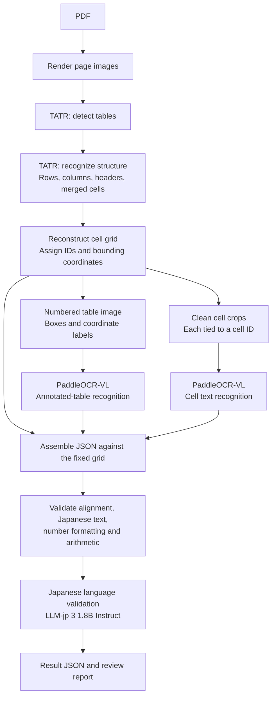

# Japanese PDF Table Parser

Parse Japanese invoice-style PDF tables into structured JSON using Microsoft
Table Transformer for geometry, PaddleOCR-VL for text, exact arithmetic checks,
and a small Japanese language model for text review.

**Status: revised architecture proposal for review.** The official PaddleOCR and
Microsoft Table Transformer references have been cloned and inspected. The
application and model inference are not implemented yet; this checkpoint follows
the request to review the architecture first.

The reconstructed Table Transformer grid determines row and column membership.
PaddleOCR-VL supplies text; Python attaches each clean-crop result to the cell ID
used in its request. The numbered overlay is also sent to PaddleOCR-VL as
requested, but generated labels are synthetic content and its output cannot
silently replace the grid or the clean-crop readings.

Use [LLM-jp 3 1.8B Instruct](https://huggingface.co/llm-jp/llm-jp-3-1.8b-instruct)
for Japanese language validation after the structural and numerical checks, just
before final status assignment and JSON export. It flags suspicious Japanese text
and returns findings associated with cell IDs. PaddleOCR-VL fine-tuning is deferred
because an appropriate dataset and training time are unavailable for this phase.

Python `Decimal` calculations decide whether amounts reconcile. Geometry
predictions, recognition, and the selected language validator still need
evaluation on Japanese invoices; adding models does not establish an accuracy or
speed improvement by itself.

For example, preserve `"2,000"` as the observed text and store `"2000"` as its parsed
decimal string. An unexpected `"2.000"` is an ambiguity to flag, rather than a
separator to silently replace.

- [Architecture, contracts, and proposed repository structure](docs/architecture.md)
- [Official sources and reference revision](docs/sources.md)

Reference clones live at `.reference/PaddleOCR/` and
`.reference/table-transformer/` and are ignored by this repository. Application
dependencies will be installed from pinned releases; upstream source will remain
separate from application code.
