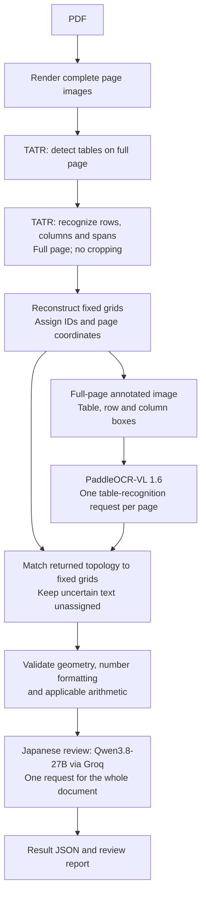
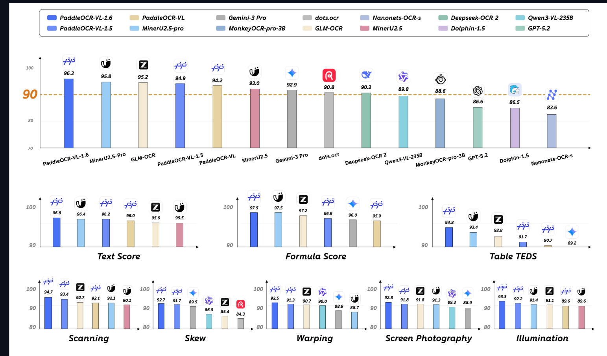

# Japanese PDF Table Parser

Parse Japanese invoice-style PDF tables into structured JSON using Microsoft
Table Transformer for geometry, PaddleOCR-VL for text, exact arithmetic checks,
and a small Japanese language model for text review.

**Status: initial implementation.** The Python CLI, model adapters, geometry,
validation, and artifact export follow the approved pipeline below. Core tests use
real PDF rendering and injected model responses; they do not establish Japanese
invoice recognition accuracy. See [implementation status](docs/progress.md).

Run the **full architecture**, including both CPU TATR models:

```powershell
.venv/Scripts/python.exe parse_document.py "input.pdf"
```

See [one-command usage](PARSE_DOCUMENT.md) for setup, compact/full JSON, schemas
and annotated PNGs. The direct-Paddle control remains in `experiments/`.
The [improvement plan](docs/improvements.md) covers annotated Japanese data,
LoRA/fine-tuning of TATR and PaddleOCR-VL 1.6, and server/edge deployment evaluation.



Each complete rendered page goes through TATR detection and structure recognition.
The page receives table, row and column boxes without cropping or changing its
coordinate origin. PaddleOCR-VL 1.6 reads that full annotated image once per page.
Python accepts text into the fixed TATR grid only when returned table topology
matches uniquely; mismatches remain reviewable raw evidence.

Qwen3.8-27B on Groq reviews the assembled document in one compact request, immediately
before final JSON export. The shipped configuration disables automatic retries and
batch splitting. Oversized or rejected reviews remain incomplete. One request can
still exceed a provider's token quota. Fine-tuning remains deferred.

Full-page TATR structure inference requires accuracy evaluation: Microsoft's
reference extraction pipeline uses detected table regions for structure recognition. This adaptation reduces
requests but does not guarantee correct boxes or Japanese transcription.

Python `Decimal` calculations decide whether amounts reconcile. Geometry
predictions, recognition, and the selected language validator still need
evaluation on Japanese invoices; adding models does not establish an accuracy or
speed improvement by itself.

For example, preserve `"2,000"` as the observed text and store `"2000"` as its parsed
decimal string. An unexpected `"2.000"` is an ambiguity to flag, rather than a
separator to silently replace.

## Setup and use

Python **3.11.14** and the complete dependency graph are pinned. Install
[uv](https://docs.astral.sh/uv/getting-started/installation/) first, then run these
PowerShell commands from this repository:

```powershell
$env:UV_CACHE_DIR = Join-Path $PWD '.cache/uv'
$env:UV_PYTHON_INSTALL_DIR = Join-Path $PWD '.cache/python'
uv sync --locked
uv run --locked pytest
uv run --locked ruff check src tests scripts experiments parse_document.py
uv run --locked ruff format --check src tests scripts experiments parse_document.py
```

For the configured CPU TATR + remote OCR/review setup:

```powershell
uv sync --locked --extra tatr
uv run --locked --extra tatr jp-pdf-parser doctor --config config.toml
uv run --locked --extra tatr jp-pdf-parser run data/invoice.pdf --config config.toml --output-dir output
```

Keep `VLMRUN_API_KEY` and `GROQ_API_KEY` in the ignored `.env` file. Local TATR
weights are pinned and verified; see [CPU setup](docs/cpu-setup.md). Optional local
OCR/reviewer adapters remain available through the `models` extra and explicit
configuration; they are never an automatic fallback.

Export the JSON Schema without installing model dependencies:

```powershell
uv run --locked jp-pdf-parser schema --output output/schema.json
```

Each run creates a new folder containing:

- `result.json`, `validation.json`, `schema.json`, and `manifest.json`.
- Complete page images, raw TATR predictions, versioned cell grids, full-page
  overlays, original PaddleOCR JSON, and `request-counts.json`.
- OCR request IDs and coordinate transforms, plus Japanese review findings and
  prompt/response traces.

Exit codes are `0` for `checks_passed`, `2` for `needs_review`, and `1` for
`failed`. Partial failures and incomplete review stages produce explicit issues;
they cannot yield `checks_passed`.

## Current invoice support

The first mapper recognizes a conservative set of Japanese/English headers for
quantity, unit price, and amount, followed by subtotal, tax, and total rows in the
detected table. It checks line multiplication, subtotal summation, and final-total
reconciliation. Configure `financial.tax_mode`, `tax_rate`, and `rounding` when the
invoice profile supplies them. Currency amounts use `money_scale` from config;
no currency is inferred solely from the document language.

Unknown headers, blank-versus-unreadable cells, unsupported adjustments, multiple
tax bases, and totals outside detected tables remain review issues. Cross-page
table merging and custom model fine-tuning are not implemented. Use
`financial.mode = "table"` for generic tables without invoice reconciliation.

The full-page table response supplies text only after exact, unique topology
matching. Unknown or ambiguous row ownership remains unassigned. The language
model returns cell-referenced findings; suggestions never change source text or
financial values. Generic-table mode does not implement balance-sheet arithmetic.

##### **Why I used the PaddleOCR VL 1.6** 



## Repository

- [Architecture, contracts, and proposed repository structure](docs/architecture.md)
- [Official sources and reference revision](docs/sources.md)
- [Implementation status and remaining work](docs/progress.md)

Reference clones live at `.reference/PaddleOCR/` and
`.reference/table-transformer/` and are ignored by this repository. Application
dependencies will be installed from pinned releases; upstream source will remain
separate from application code.
