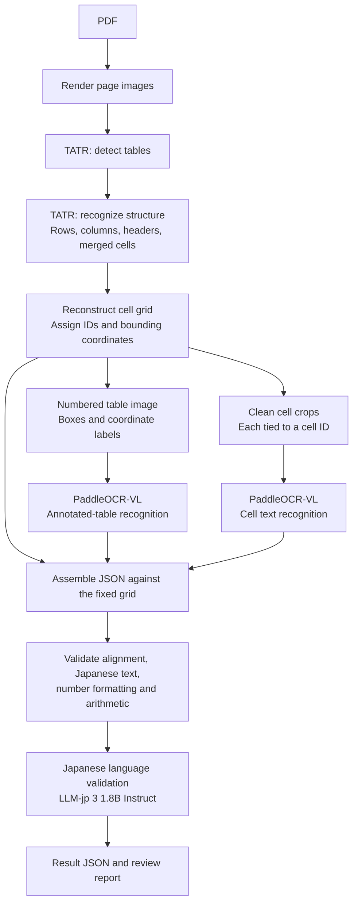

# Japanese PDF Table Parser

Parse Japanese invoice-style PDF tables into structured JSON using Microsoft
Table Transformer for geometry, PaddleOCR-VL for text, exact arithmetic checks,
and a small Japanese language model for text review.

**Status: initial implementation.** The Python CLI, model adapters, geometry,
validation, and artifact export follow the approved pipeline below. Core tests use
real PDF rendering and injected model responses; they do not establish Japanese
invoice recognition accuracy. See [implementation status](docs/progress.md).
Both real TATR checkpoints are downloaded and verified on CPU, including offline
inference. PaddleOCR and Japanese-review API adapters are still pending.



The reconstructed Table Transformer grid determines row and column membership.
PaddleOCR-VL supplies text; Python attaches each clean-crop result to the cell ID
used in its request. The numbered overlay is also sent to PaddleOCR-VL as
requested, but generated labels are synthetic content and its output cannot
silently replace the grid or the clean-crop readings.

Use [LLM-jp 3 1.8B Instruct](https://huggingface.co/llm-jp/llm-jp-3-1.8b-instruct)
for Japanese language validation after the structural and numerical checks, just
before final status assignment and JSON export. It flags suspicious Japanese text
and returns findings associated with cell IDs. PaddleOCR-VL fine-tuning is deferred
because an appropriate dataset and training time are unavailable for this phase.

Python `Decimal` calculations decide whether amounts reconcile. Geometry
predictions, recognition, and the selected language validator still need
evaluation on Japanese invoices; adding models does not establish an accuracy or
speed improvement by itself.

For example, preserve `"2,000"` as the observed text and store `"2000"` as its parsed
decimal string. An unexpected `"2.000"` is an ambiguity to flag, rather than a
separator to silently replace.

## Setup and use

Python **3.11.14** and the complete dependency graph are pinned. Install
[uv](https://docs.astral.sh/uv/getting-started/installation/) first, then run these
PowerShell commands from this repository:

```powershell
$env:UV_CACHE_DIR = Join-Path $PWD '.cache/uv'
$env:UV_PYTHON_INSTALL_DIR = Join-Path $PWD '.cache/python'
uv sync --locked
uv run --locked pytest
uv run --locked ruff check src tests
uv run --locked ruff format --check src tests
```

For local CPU TATR, use the smaller runtime extra:

```powershell
uv sync --locked --extra tatr
uv run --locked --extra tatr jp-pdf-parser download-tatr
uv run --locked --extra tatr jp-pdf-parser check-tatr
```

The two pinned checkpoints, image processor configs, and model cards live under
`models/tatr/detection/` and `models/tatr/structure/` (about 231 MB total).
They are present on this workstation and ignored by Git. `download-tatr` checks
SHA-256 hashes and skips intact files. Once downloaded, TATR loads only local
files and never downloads another backbone. Missing or altered files fail with a
clear error. See [CPU setup and model/API choices](docs/cpu-setup.md).

`check-tatr` runs both actual models on a synthetic table and writes timings,
raw objects, input images, and provenance to `output/tatr-check/`. It can also
accept `--image data/page.png`. This checks execution; it does not measure invoice
accuracy. No PaddleOCR or language-model inference is run by this command.

For the existing full **local** inference path, install the complete extra:

```powershell
uv sync --locked --extra models
uv run --locked --extra models jp-pdf-parser doctor --config config.toml
uv run --locked --extra models jp-pdf-parser run data/invoice.pdf --config config.toml --output-dir output
```

`doctor` checks dependency presence and configuration; it does not download
weights or certify inference. A real `run` uses the local TATR files; its current
PaddleOCR and LLM-jp adapters still download their pinned revisions into
`.cache/huggingface` on first use. Hosted API adapters are not implemented yet,
so providing a token alone does not switch this command to remote inference.
Full local CPU inference can require substantial RAM and time. The tested Windows
installation uses CPU builds of PyTorch and Paddle.

Export the JSON Schema without installing model dependencies:

```powershell
uv run --locked jp-pdf-parser schema --output output/schema.json
```

Each run creates a new folder containing:

- `result.json`, `validation.json`, `schema.json`, and `manifest.json`.
- Rendered pages, raw TATR detections, versioned cell grids, numbered overlays,
  clean cell crops, and original PaddleOCR JSON.
- OCR request IDs and coordinate transforms, plus Japanese review findings and
  prompt/response traces.

Exit codes are `0` for `checks_passed`, `2` for `needs_review`, and `1` for
`failed`. Partial failures and incomplete review stages produce explicit issues;
they cannot yield `checks_passed`.

## Current invoice support

The first mapper recognizes a conservative set of Japanese/English headers for
quantity, unit price, and amount, followed by subtotal, tax, and total rows in the
detected table. It checks line multiplication, subtotal summation, and final-total
reconciliation. Configure `financial.tax_mode`, `tax_rate`, and `rounding` when the
invoice profile supplies them. Currency amounts use `money_scale` from config;
no currency is inferred solely from the document language.

Unknown headers, blank-versus-unreadable cells, unsupported adjustments, multiple
tax bases, and totals outside detected tables remain review issues. Cross-page
table merging and custom model fine-tuning are not implemented. Use
`financial.mode = "table"` for generic tables without invoice reconciliation.

The numbered-table result is compared only when its HTML cell topology matches
the fixed grid. It never supplies missing cell text by ordinal position. The
language model returns cell-referenced findings; suggestions are not silently
applied to OCR text or financial values.

## Repository

- [Architecture, contracts, and proposed repository structure](docs/architecture.md)
- [Official sources and reference revision](docs/sources.md)
- [Implementation status and remaining work](docs/progress.md)
- [Local CPU TATR and hosted model options](docs/cpu-setup.md)

Reference clones live at `.reference/PaddleOCR/` and
`.reference/table-transformer/` and are ignored by this repository. Application
dependencies will be installed from pinned releases; upstream source will remain
separate from application code.
