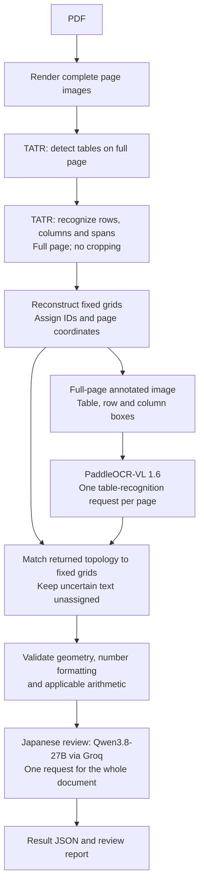

# Full-page document parser architecture

The active pipeline keeps complete page images throughout. It creates no table
or cell crops, and it has no automatic crop fallback. TATR runs locally on CPU;
PaddleOCR-VL 1.6 and Qwen3.8-27B use the configured APIs.

## Pipeline



## Stages and request boundaries

1. **Intake and rendering.** Check PDF signature, size, page count and raster limits.
   Render pages sequentially with PDFium at 300 DPI. Preserve each clean page and
   its invertible image-to-PDF transform.
2. **Table detection.** Feed each complete page to Microsoft's pinned TATR detection
   model. Save raw predictions and suppress overlapping duplicate table detections.
3. **Structure recognition.** Feed the same complete, unannotated page to the pinned
   TATR structure model once. Keep predictions in page pixels. Associate axes and
   spans with a table only when ownership is unambiguous. No table image is cropped
   or rotated. Rotated or ambiguous structures remain explicit review issues.
4. **Grid reconstruction.** Order rows and columns, refine shared boundaries, derive
   cell intersections, and reconstruct non-conflicting merged cells. Assign stable
   page/table/grid/row/column IDs. Save coordinates and original model scores.
5. **Annotation.** Copy the complete page without changing its dimensions or origin.
   Draw green table boxes, blue row boxes and IDs, and orange column boxes and IDs.
   The table label includes its page coordinates. All row, column and cell coordinates
   are available in the grid JSON; a large coordinate legend is not added to the image.
6. **Recognition.** Send this annotated page once to PaddleOCR-VL with `method="table"`.
   VLM Run returns OTSL text, which Python converts to explicit HTML rows and spans.
   The adapter may resize the entire page to its pixel budget, preserving aspect
   ratio and recording the resize transform. It never crops. Text prompts beside
   an image are ignored by this endpoint; we cannot require custom cell-ID JSON.
7. **Assembly.** Match every returned table to a unique TATR grid by exact row,
   column and span topology. Require a complete, unambiguous table assignment.
   Only then bind text to canonical cell IDs. Preserve the raw response and leave
   cells unassigned on a mismatch. Never slide later values into earlier rows,
   invent missing boxes, or let the language model change the grid.
8. **Deterministic validation.** Check grid ownership, coordinate transforms,
   missing text, number formatting and applicable invoice arithmetic.
9. **Japanese review.** Submit all document cells in one request to Groq. Use compact
   temporary IDs (`c1`, `c2`, ...) to reduce repeated tokens, and store the mapping
   to canonical IDs in the trace. Include table membership, rows, columns, spans
   and completed rule statuses. Validate exact review coverage and known finding
   IDs, then map findings back. Suggestions never overwrite OCR text.
10. **Export.** Save result, validation, schema, manifest, request counts and evidence
    to a unique run directory. Partial failures remain visible.

## Limits and guarantees

- With the shipped configuration, a one-page document with a detected table uses
  **one PaddleOCR-VL request and at most one Groq request**. Multiple pages require
  one OCR request per page with tables; Japanese review remains document-level.
- There are no automatic OCR retries. Groq `format_retries=0` and `max_requests=1`
  prevent hidden review retries. If no OCR text could be assigned to cells, review
  is skipped with an explicit issue rather than sending an empty draft. Credentials
  never enter artifacts or logs.
- Groq's configured review context is 32,768 tokens, with 2,048 output tokens.
  UTF-8 byte length plus schema/framing overhead conservatively bounds input.
  An oversized document is marked incomplete without splitting or truncation.
  Provider token quotas still apply to a single request.
- Microsoft's reference extraction pipeline runs structure recognition on detected
  table regions. This requested
  full-page mode is an adaptation and requires accuracy evaluation, especially
  for small tables, multiple tables and rotations. Neither more boxes nor an
  internally consistent grid proves alignment with printed text.
- Identical table topologies on the same page cannot be assigned uniquely from
  this endpoint's output. Preserve the response and require review in that case.
- Annotations can affect OCR, and full-page resizing can reduce small-text detail.
  Labels are kept short, without the old large side legend. Accuracy is measured
  separately from request count.

## Data and financial rules

Pydantic is the source of truth for JSON Schema. Schema 1.1 adds page-level OCR
readings and explicit structure coordinate frames. Historical reading variants
remain readable; new runs create only `annotated_page` readings.

- `Page`: PDF geometry, rendered geometry, image-to-PDF transform, image path,
  one annotated OCR reading, tables and issues.
- `Table`: detection box, structure coordinate frame, rows, columns, cells, spans,
  geometry status and optional invoice view.
- `Cell`: canonical ID, row/column ownership, spans, page bbox, immutable raw text,
  separate normalized text and optional decimal string, shared OCR evidence.
- `JapaneseReview`: completion, canonical reviewed IDs and advisory findings.
- `Manifest`: source/artifact hashes, dependencies, code hashes, effective config,
  model revisions, backend identities and timings.

All active geometry uses rendered-page pixels and identity table-to-page transforms.
The PDF renderer transform maps these coordinates back to source PDF points.
TATR scores are layout confidence, not transcription confidence.

Preserve `2,000` as raw text. Parse a separate copy with exact `Decimal` arithmetic
only after thousands grouping is valid. Never replace decimal points with commas
or change a value to force a total to balance. Full-width digits and supported
negative conventions are handled explicitly. Serialize parsed decimals as strings.

Invoice mapping recognizes conservative quantity, unit-price and amount headers,
then subtotal, tax and total rows. Check multiplication and summation only when
operands and semantics are known. Tax rates, inclusive/exclusive policy, currency
scale and rounding come from configuration; no financial policy is guessed.
Missing operands produce incomplete checks. Generic `financial.mode="table"`
reports invoice checks as not applicable. Balance-sheet reconciliation is not
implemented by that profile.

## Repository and artifacts

Application logic and tests remain Python. See `src/jp_pdf_parser/` for rendering,
TATR adapters, grid reconstruction, page OCR, table binding, deterministic rules,
Japanese review, API transport and artifact writing. See `tests/` for model-free
contracts and `docs/sources.md` for upstream references. Pinned CPU TATR assets
remain in `models/tatr/`; the reference checkouts are not runtime dependencies.

```text
output/<run>/
  result.json
  validation.json
  schema.json
  manifest.json
  request-counts.json
  pages/p001.png
  pages/p001-detections.json
  pages/p001-structure.json
  pages/p001-annotated.png
  pages/p001-ocr-request.json
  tables/p1-t1/grid-g1.json
  ocr/p1-annotated-a1.json
  japanese-review.json
  japanese-traces.json
```

No `cells/`, cropped `source.png`, or per-cell API response files are generated.
Old run directories remain unchanged as historical evidence.

## Verification and remaining work

Tests cover no-crop execution, full-page dimensions and transforms, one OCR call
per page, one document-level review, merged cells, malformed OTSL/HTML, ambiguous
mapping, missing IDs, provider failures, context overflow, number grouping and
financial rules. Injected model tests establish contracts, not recognition accuracy.

Before treating extraction as reliable, evaluate full-page TATR alignment and
Japanese/amount transcription against annotated documents. Resolve uncertain
structure and recognition without silently assigning mismatched rows. Add explicit
balance-sheet accounting profiles separately when required.


## Improvements: Japanese-domain fine-tuning and deployment

Improve layout and recognition using well-annotated Japanese table data: exact
cell text, table/row/column boxes, spans, reading order, units and amount formatting.
Evaluate LoRA for both TATR and PaddleOCR-VL 1.6, with compatible adapter targets,
conventional fine-tuning baselines and held-out layouts. Small updates may help,
but improvement must be measured. Compact models make modest server hosting and
TATR on capable edge devices worth investigating; no device suitability is guaranteed.

See [improvements.md](improvements.md) for source-backed training options, dataset
requirements, deployment constraints and acceptance measurements. Training/custom
serving is future work; the final script currently runs the existing pinned models.
